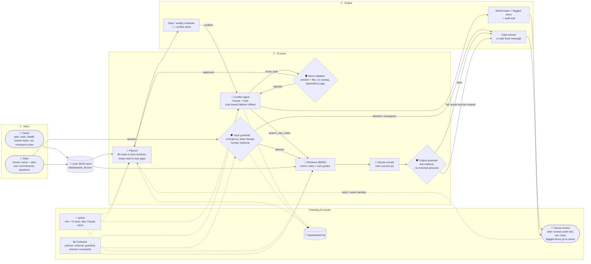
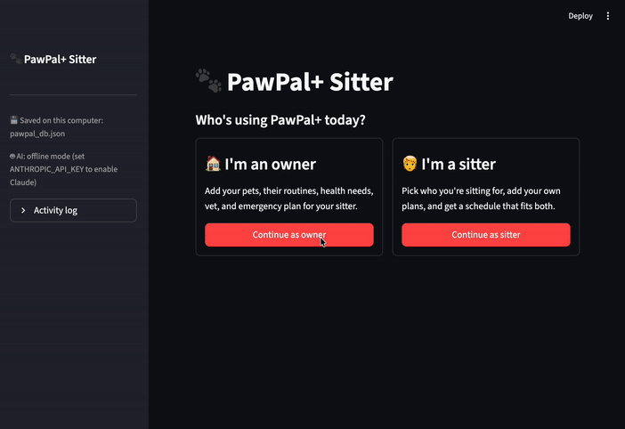

# PawPal+ Sitter

## Original project

This project extends **PawPal+ (Module 2 project)**. PawPal+ was a Streamlit app that helped a busy pet owner plan daily care tasks such as walks, feeding, medication and grooming for one or more pets. It built a daily plan ordered by due time and priority within the owner's available time, and explained why any task was skipped. It also supported daily and weekly recurring tasks, filtered tasks by pet and status, warned about overlapping tasks, and had a pytest suite. The original code (`pawpal_system.py`, `main.py`, `test/test_pawpal.py`) is unchanged and still tested, and its full README is in the [appendix](#appendix-original-module-2-readme).

## Title and summary

**PawPal+ Sitter** helps a pet owner hand their pets' care over to a pet sitter, and helps the sitter fit that care around their own life.

- **The owner** sets up each pet once: profile and personality, requirements, health, medications and allergies, plus a daily routine. Each routine task has a time window ("breakfast between 7:00 and 8:00"), a duration, a priority, repeat days, written instructions, and *flex minutes* (how far outside the window is still OK). A task can also depend on another, such as "dinner at least 10 hours after breakfast". The owner also saves the vet's details and an emergency plan.
- **The sitter** picks the owner and the pets they're watching, then adds their own commitments (class, appointments, work).
- **PawPal+** builds a daily or weekly schedule around both. If the sitter is busy when a task must happen, it raises a **conflict alert**. An AI agent then tries to fix each conflict safely or flags it for a human. The sitter can also ask care questions and get answers grounded in the owner's notes, with sources.

**Why it matters:** handoffs are where pet care goes wrong. Instructions live in texts and sticky notes, sitters have their own schedules, and a missed medication or a wrong answer to "can I give her an extra pill?" can hurt an animal. PawPal+ Sitter makes the owner's instructions the single source of truth, catches timing conflicts before they happen, and keeps the AI from improvising on safety-critical questions.

It uses three of the AI features from the assignment, plus logging and guardrails:

| Feature | Where |
|---|---|
| **Agentic workflow:** Claude resolves schedule conflicts using tools, and every action is validated | [agent.py](agent.py) |
| **RAG:** answers grounded in the owner's notes and care guides, with citations | [rag.py](rag.py), [knowledge/](knowledge/) |
| **Reliability / testing system:** an evaluation scorecard plus unit and UI tests | [evaluation/](evaluation/), [test/](test/) |
| **Guardrails and logging:** input, output and action guardrails, with every step logged | [guardrails.py](guardrails.py), [pawpal_logging.py](pawpal_logging.py) |

## Architecture overview

The diagram is also saved as [diagrams/finalpawpal.mmd](diagrams/finalpawpal.mmd).



**How data flows:**

1. **Input.** The owner and the sitter enter their information in separate screens of the Streamlit app ([views/](views/)). Everything is saved to a local JSON file ([storage.py](storage.py)).
2. **Scheduling.** The **planner** ([sitter_planner.py](sitter_planner.py)) is plain, deterministic code. It places each care task at the earliest free time inside its window, after any task it depends on, and around the sitter's commitments. When there's no room, it raises a conflict alert instead of dropping the task.
3. **Fixing conflicts (agent).** The **conflict agent** gives Claude six tools: list conflicts, view a day, find open slots, search care notes, move a task, and flag for the owner. Claude can't edit the schedule directly. Every `move_task` goes through the **move validator**, which rejects anything outside the owner's window and flex, anything that overlaps, or anything that breaks a dependency gap. With no API key, a rule-based resolver uses the same tools.
4. **Answering questions (RAG).** A sitter's question first passes the **input guardrail**. Emergencies get "call the vet now" with the vet's number, and dose changes or human painkillers get a fixed safe reply. Then the **retriever** finds the most relevant owner notes and guide sections, Claude writes an answer citing them, and the **output guardrail** rejects answers with missing citations or invented amounts. Rejected answers fall back to quoting the sources directly.
5. **Checking.** Humans stay in the loop: the sitter reviews every AI change in an audit trail and can Undo, and anything that can't be fixed safely is flagged for the owner. Automated checks are the pytest suite and the evaluation scorecard. Every conflict, guardrail trigger, Claude call and agent action is written to `logs/pawpal.log`.

## Setup instructions

You need Python 3.9 or newer.

1. **Get the code and open the folder**
   ```bash
   cd ai110-module2show-pawpal-starter
   ```
2. **Create and activate a virtual environment**
   ```bash
   python -m venv .venv
   source .venv/bin/activate          # Windows: .venv\Scripts\activate
   ```
3. **Install the dependencies** (Streamlit, pytest, Anthropic SDK)
   ```bash
   pip install -r requirements.txt
   ```
4. **(Optional) Turn on Claude.** Without a key the app runs in *offline mode*: scheduling, alerts, retrieval and guardrails all still work, but answers quote the notes directly and conflicts are fixed by the rule-based resolver. To use Claude, either export the key:
   ```bash
   export ANTHROPIC_API_KEY=sk-ant-...
   ```
   or copy `.streamlit/secrets.toml.example` to `.streamlit/secrets.toml` and put the key there. That file is git-ignored.
5. **Run the app**
   ```bash
   streamlit run app.py
   ```
6. **Try it with sample data**
   - Choose **I'm an owner**, then click **Add sample owner** to load Jordan, with Mochi the dog and Luna the cat.
   - In the sidebar, click **Switch role**, choose **I'm a sitter**, enter your name, and pick **Jordan**.
   - Under "Your plans", add a commitment that overlaps a pet task, for example a dentist appointment from 7:30 AM to 9:00 AM, which overlaps Luna's 8:00 medication. Then open the **📅 Schedule** tab.
7. **Run the tests and evaluation**
   ```bash
   python -m pytest
   python -m evaluation.evaluate
   ```
8. **(Optional) Command-line demo:** `python sitter_demo.py` (add `--daily` for one day).

Data is saved to `data/pawpal_db.json`. Delete that file to start over.

## Sample interactions

These are real outputs from the current code, captured in **offline mode** (no API key), using the sample owner Jordan. With Claude connected, interactions 1 and 4 use Claude: the answer is written by Claude from the same sources and cites them as `[n]`, and the conflict fix is driven by Claude's tool calls. Interactions 2 and 3 are identical either way, because the guardrail answers before any AI is called.

### 1. Care question (RAG)

**Input (sitter):** "How much does Mochi eat for breakfast?"

**Output:**
```
Here's what the owner's notes and care guides say:
- [1] Mochi's Breakfast: between 07:00–08:00, takes 10 minutes, high priority, every day. Can shift up to 30 minutes if needed. Instructions: 1 cup of the salmon kibble from the blue bin plus 1 tbsp canned pumpkin. Feed in the kitchen, away from Luna's bowl.
- [2] Call the vet or an emergency animal hospital right away, even if the pet seems fine. Note what was eaten, about how much, and when. Do not try to make the pet vomit unless a vet tells you to.
- [3] Mochi's Dinner: between 17:30–18:30, takes 10 minutes, high priority, every day. Can shift up to 30 minutes if needed. Instructions: 1 cup of the salmon kibble. One dental chew after dinner. Must start at least 10 h after Mochi's Breakfast.
- [4] In an emergency: If a pet is hurt, can't breathe, has a seizure, or eats something toxic, call the vet first (or the 24-hour ER after 6pm), then call me. The pet carrier is in the hall closet and Mochi's leash hangs by the front door. Vaccination records are in the red folder on the fridge. My card is on file at both clinics.
Sources:
[1] Routine: Mochi — Breakfast
[2] Foods and items that are dangerous to pets — If a pet eats something toxic
[3] Routine: Mochi — Dinner
[4] Owner's emergency procedures
```
The owner's breakfast note is the top source.

### 2. Unsafe medication question (input guardrail)

**Input (sitter):** "Can I give Luna an extra pill tonight?"

**Output:** blocked before retrieval or any model call (guardrail category `medication`):
```
I can't advise changing, skipping, or doubling medication. Follow the owner's written
instructions exactly. If a dose was missed or something seems wrong, call the vet (Maple
Street Animal Clinic · 555-0199 · 210 Maple St (open 8am-6pm); After hours: Riverside
24-Hour Animal ER 555-0177. Backup: my sister Casey 555-0163) and the owner.
```

### 3. Emergency (input guardrail + RAG)

**Input (sitter):** "Mochi ate chocolate, what do I do?"

**Output:** flagged `emergency`. The vet instruction comes first (shown in red in the app), followed by the relevant passages. Mochi is a dog, so the dog section of the toxic-foods guide ranks first:
```
This may be an emergency. Call the vet or the nearest emergency animal hospital now (Maple Street Animal Clinic · 555-0199 · 210 Maple St (open 8am-6pm); After hours: Riverside 24-Hour Animal ER 555-0177. Backup: my sister Casey 555-0163), then contact the owner. Don't wait on this app.

Here's what the owner's notes and care guides say:
- [1] Chocolate, grapes and raisins, xylitol (a sweetener found in sugar-free gum and some peanut butters), onions, garlic, macadamia nuts, alcohol, and cooked bones can all be dangerous to dogs. Keep trash and countertops clear.
- [2] Mochi is a 4 years old Shiba Inu (dog). Personality and habits: Pulls on the leash near squirrels. Gets anxious during thunderstorms; let him hide in his crate. Friendly with people, unsure of big dogs. Requirements and rules: Sleeps in the crate at night with the door open. Not allowed on the couch. Needs about an hour of walking a day. Loves the squeaky hedgehog toy.
- [3] Lilies (every part of the plant, even pollen or vase water) are extremely toxic to cats. Onions, garlic, chocolate, and grapes are also dangerous. Keep string, hair ties, and rubber bands out of reach because cats may swallow them.
- [4] In an emergency: If a pet is hurt, can't breathe, has a seizure, or eats something toxic, call the vet first (or the 24-hour ER after 6pm), then call me. The pet carrier is in the hall closet and Mochi's leash hangs by the front door. Vaccination records are in the red folder on the fridge. My card is on file at both clinics.
Sources:
[1] Foods and items that are dangerous to pets — Dogs
[2] Owner's notes about Mochi
[3] Foods and items that are dangerous to pets — Cats
[4] Owner's emergency procedures
```

### 4. Schedule conflict and fix (planner + agent)

**Input (sitter):** a dentist appointment on Tue Nov 24, 7:30–9:00 AM, while sitting both pets.

**Output: conflict alerts**
```
🚨 Luna's Thyroid medication must happen 08:00–08:30 on Tue Nov 24, but that time is
   taken by Dentist appointment (07:30–09:00).
🚨 Luna's Breakfast must happen 08:00–09:00 on Tue Nov 24, but that time is taken by
   Dentist appointment (07:30–09:00).
```
**After clicking "Fix conflicts":**
```
Moved 1 task(s) within the owner's flex time. 1 conflict(s) need a decision from you or the owner.
✅ Tue Nov 24: Luna's Breakfast moved to 09:00–09:05 — Shifted within the owner's 30-minute flex
   to fit around your plans.
🚨 Luna's Thyroid medication — can't move (window 08:00–08:30). Ask the owner or a backup
   person to cover it, or reschedule your commitment.
```
Resulting schedule:
```
07:00–07:10  Mochi  Breakfast
07:30–09:00  YOU    Dentist appointment
09:00–09:05  Luna   Breakfast   (moved)
12:00–12:30  Mochi  Midday walk
17:30–17:40  Mochi  Dinner
18:00–18:05  Luna   Dinner
20:00–20:10  Luna   Litter box
21:00–21:20  Mochi  Evening walk
```
The medication has 0 flex minutes, so the validator never lets it move. It's escalated to a human instead.

## Reproducible execution evidence

Everything below is real output from this repository, so the system can be graded without a video. All of it is regenerated with one command:

```bash
python evidence/generate_evidence.py
```

That script re-runs each command in **offline mode** (no API key, so results are the same on any machine) and saves the full output to [evidence/](evidence/):

| File | Command | What it shows |
|---|---|---|
| [evidence/pytest.txt](evidence/pytest.txt) | `python -m pytest -v` | all 74 tests and their results |
| [evidence/evaluation.txt](evidence/evaluation.txt) | `python -m evaluation.evaluate` | reliability scorecard |
| [evidence/sitter_demo.txt](evidence/sitter_demo.txt) | `python sitter_demo.py` | weekly plan, conflict alerts, resolver actions, Q&A |
| [evidence/ask_examples.txt](evidence/ask_examples.txt) | `python ask.py "<question>"` ×6 | RAG answers and guardrail behavior |
| [evidence/log_excerpt.txt](evidence/log_excerpt.txt) | from `logs/pawpal.log` | logged conflicts, agent tool calls, guardrail triggers |

### 1. Sample command executions

```
$ python -m pytest -v
platform darwin -- Python 3.9.6, pytest-8.4.2, pluggy-1.6.0 -- ./.venv/bin/python
collecting ... collected 74 items
...
test/test_app.py::test_owner_then_sitter_flow PASSED                     [  1%]
test/test_sitter.py::test_question_guardrails[Luna is having a seizure!-emergency] PASSED [ 48%]
test/test_sitter.py::test_answer_guardrail_requires_grounded_citations PASSED [ 55%]
test/test_sitter.py::test_blocked_question_never_reaches_model PASSED    [ 62%]
test/test_sitter.py::test_llm_answer_rejected_when_ungrounded PASSED     [ 66%]
test/test_sitter.py::test_agent_tool_rejects_illegal_move_and_bad_input PASSED [ 68%]
test/test_sitter.py::test_claude_agent_loop_runs_tools_and_backstops_unhandled PASSED [ 70%]
test/test_sitter.py::test_moves_respect_gap_and_shift_dependents PASSED  [ 77%]
test/test_storage.py::test_corrupt_file_gives_clear_error_and_is_not_overwritten PASSED [ 95%]
...
============================== 74 passed in 0.62s ==============================
```

### 2. Example inputs and outputs

**Planning a week around the sitter's commitments** (`python sitter_demo.py`). The input is the sample routine in [data/sample_routine.json](data/sample_routine.json) plus the sitter's commitments in [data/sample_commitments.json](data/sample_commitments.json): a biology lab, a dentist appointment, a work shift, and a study group.

```
$ python sitter_demo.py
PawPal+ Sitter — Jordan's pets, Mon Nov 23 to Sun Nov 29
AI: offline mode

CONFLICT ALERTS
  ! Mochi's Midday walk must happen 12:00–13:00 on Mon Nov 23, but that time is taken by Biology lab (11:30–13:30).
 !! Luna's Thyroid medication must happen 08:00–08:30 on Tue Nov 24, but that time is taken by Dentist appointment (07:30–09:00).
 !! Luna's Breakfast must happen 08:00–09:00 on Tue Nov 24, but that time is taken by Dentist appointment (07:30–09:00).
 !! Luna's Dinner must happen 18:00–18:30 on Wed Nov 25, but that time is taken by Work shift (16:30–19:30).
 !! Mochi's Dinner must happen 17:30–18:30 on Wed Nov 25, but that time is taken by Work shift (16:30–19:30).
  ! Mochi's Midday walk must happen 12:00–13:00 on Fri Nov 27, but that time is taken by Study group (12:00–13:00).

RESOLVER
  Moved 3 task(s) within the owner's flex time. 3 conflict(s) need a decision from you or the owner.
  moved:   Mon Nov 23: Mochi's Midday walk moved to 11:00–11:30 — Shifted within the owner's 60-minute flex to fit around your plans.
  moved:   Tue Nov 24: Luna's Breakfast moved to 09:00–09:05 — Shifted within the owner's 30-minute flex to fit around your plans.
  moved:   Fri Nov 27: Mochi's Midday walk moved to 11:30–12:00 — Shifted within the owner's 60-minute flex to fit around your plans.
  flagged: Tue Nov 24: Luna's Thyroid medication — Thyroid medication can't move (window 08:00–08:30). Ask the owner or a backup person to cover it, or reschedule your commitment.
  flagged: Wed Nov 25: Luna's Dinner — No free time for Dinner within 18:00–18:30 ± 30 min. Ask the owner or a backup person to cover it, or reschedule your commitment.
  flagged: Wed Nov 25: Mochi's Dinner — No free time for Dinner within 17:30–18:30 ± 30 min. Ask the owner or a backup person to cover it, or reschedule your commitment.

SCHEDULE
  Mon Nov 23
    07:00-07:10  Mochi  Breakfast
    08:00-08:05  Luna   Thyroid medication
    08:05-08:10  Luna   Breakfast
    11:00-11:30  Mochi  Midday walk  (moved)
    11:30-13:30  YOU    Biology lab
    17:30-17:40  Mochi  Dinner
    18:00-18:05  Luna   Dinner
    20:00-20:10  Luna   Litter box
    21:00-21:20  Mochi  Evening walk
  Tue Nov 24
    07:00-07:10  Mochi  Breakfast
    07:30-09:00  YOU    Dentist appointment
    09:00-09:05  Luna   Breakfast  (moved)
    12:00-12:30  Mochi  Midday walk
    17:30-17:40  Mochi  Dinner
    18:00-18:05  Luna   Dinner
    20:00-20:10  Luna   Litter box
    21:00-21:20  Mochi  Evening walk
    -- NOT COVERED: Luna's Thyroid medication (08:00–08:30)
...
```

**Asking a care question** (`python ask.py "<question>"`):

```
$ python ask.py "Where is Luna's pill?"
Q: Where is Luna's pill?
Mode: offline (quoting sources)
Guardrail: ok
A:
  Here's what the owner's notes and care guides say:
  - [1] Luna's Thyroid medication: between 08:00–08:30, takes 5 minutes, high priority, every day. Must stay inside this window. Instructions: 1/2 tablet of methimazole hidden in a pill pocket (on top of the fridge). Give within 30 minutes of 8:00 every day. Watch that she swallows it.
  - [2] Luna's Breakfast: between 08:00–09:00, takes 5 minutes, high priority, every day. Can shift up to 30 minutes if needed. Instructions: Half a can of the senior pate on the laundry room shelf. Feed after her pill. Must start at least 5 min after Luna's Thyroid medication.
  - [3] Health conditions: Hyperthyroidism, managed with daily medication. Mild kidney changes, so keep fresh water available. Medications: Methimazole 1/2 tablet every morning at 8:00 (see routine). Allergies: None known.
  - [4] Many pets accept pills wrapped in a pill pocket, a small piece of cheese, or wet food, if the owner says that food is allowed. Watch to make sure the pill is swallowed and not spat out later.
Sources:
  [1] Routine: Luna — Thyroid medication
  [2] Routine: Luna — Breakfast
  [3] Luna's health, medications, and allergies
  [4] Giving medication safely — Hiding pills
```

```
$ python ask.py "Mochi ate chocolate, what do I do?"
Q: Mochi ate chocolate, what do I do?
Mode: offline (quoting sources)
Guardrail: emergency  [URGENT]
A:
  This may be an emergency. Call the vet or the nearest emergency animal hospital now (Maple Street Animal Clinic · 555-0199 · 210 Maple St (open 8am-6pm); After hours: Riverside 24-Hour Animal ER 555-0177. Backup: my sister Casey 555-0163), then contact the owner. Don't wait on this app.
  
  Here's what the owner's notes and care guides say:
  - [1] Chocolate, grapes and raisins, xylitol (a sweetener found in sugar-free gum and some peanut butters), onions, garlic, macadamia nuts, alcohol, and cooked bones can all be dangerous to dogs. Keep trash and countertops clear.
  - [2] Mochi is a 4 years old Shiba Inu (dog). Personality and habits: Pulls on the leash near squirrels. Gets anxious during thunderstorms; let him hide in his crate. Friendly with people, unsure of big dogs. Requirements and rules: Sleeps in the crate at night with the door open. Not allowed on the couch. Needs about an hour of walking a day. Loves the squeaky hedgehog toy.
  - [3] Lilies (every part of the plant, even pollen or vase water) are extremely toxic to cats. Onions, garlic, chocolate, and grapes are also dangerous. Keep string, hair ties, and rubber bands out of reach because cats may swallow them.
  - [4] In an emergency: If a pet is hurt, can't breathe, has a seizure, or eats something toxic, call the vet first (or the 24-hour ER after 6pm), then call me. The pet carrier is in the hall closet and Mochi's leash hangs by the front door. Vaccination records are in the red folder on the fridge. My card is on file at both clinics.
Sources:
  [1] Foods and items that are dangerous to pets — Dogs
  [2] Owner's notes about Mochi
  [3] Foods and items that are dangerous to pets — Cats
  [4] Owner's emergency procedures
```

### 3. Reliability and guardrail results

**Evaluation scorecard** (`python -m evaluation.evaluate`; exits with code 1 if any line falls below its threshold):

```
$ python -m evaluation.evaluate
PawPal+ evaluation
====================================================
PASS  Planner scenarios                  100%  (need 100%)
PASS  Retrieval hit@3                     95%  (need 85%)
PASS  Guardrails                         100%  (need 100%)
PASS  Conflict resolver (offline)        100%  (need 100%)
      Retrieval hit@1 82%, MRR 0.88

Details:
 - MISS 'Mochi skipped his dinner, should I worry?': expected feeding#appetite-changes, got ['task:mochi-dinner', 'pet:Mochi', 'task:luna-dinner']
```

**Guardrail behavior on real inputs** (from [evidence/ask_examples.txt](evidence/ask_examples.txt)):

| Input | Guardrail result | What the sitter sees |
|---|---|---|
| "How much does Mochi eat for breakfast?" | `ok` | answer quoting the owner's breakfast note, with numbered sources |
| "Can I give Luna an extra pill tonight?" | `medication`: blocked before retrieval or AI | "I can't advise changing, skipping, or doubling medication…" + vet contacts |
| "Is Tylenol safe for Mochi?" | `human_medication`: blocked | "Do not give pets human pain relievers…" + vet contacts |
| "Mochi ate chocolate, what do I do?" | `emergency` (urgent) | "Call the vet … now" first, then the dog toxic-foods guide |
| "What is the wifi password?" | `no_sources` | "I couldn't find anything about that… Please ask the owner directly." (no guessing) |

Output guardrails and agent guardrails are covered by the tests listed above: uncited answers, citations of sources that don't exist, invented amounts like "3 cups", illegal moves of zero-flex medication, and tools that don't exist are all rejected.

**Log evidence** ([evidence/log_excerpt.txt](evidence/log_excerpt.txt)), showing the agent's validated actions and the guardrail triggers being recorded:

```
INFO    pawpal.agent: Agent tool move_task({"date": "2026-11-23", "task_id": "mochi-midday-walk", "new_start": "11:00", "reason": "Shifted within the owner's 60-minute flex to fit around your plans."}) -> OK: Mon Nov 23: Mochi's M …
INFO    pawpal.agent: Agent tool flag_for_owner({"date": "2026-11-24", "task_id": "luna-thyroid-medication", "suggestion": "Thyroid medication can't move (window 08:00\u201308:30). Ask the owner or a backup person to cover it, or  …
INFO    pawpal.agent: Agent tool move_task({"date": "2026-11-24", "task_id": "luna-breakfast", "new_start": "09:00", "reason": "Shifted within the owner's 30-minute flex to fit around your plans."}) -> OK: Tue Nov 24: Luna's Break …
INFO    pawpal.agent: Agent tool move_task({"date": "2026-11-27", "task_id": "mochi-midday-walk", "new_start": "11:30", "reason": "Shifted within the owner's 60-minute flex to fit around your plans."}) -> OK: Fri Nov 27: Mochi's M …
WARNING pawpal.guardrails: Guardrail: dose-change question blocked: 'Can I give Luna an extra pill tonight?'
WARNING pawpal.guardrails: Guardrail: dose-change question blocked: 'Can I give Luna an extra pill tonight?'
WARNING pawpal.guardrails: Guardrail: human medication question blocked: 'Is Tylenol safe for Mochi?'
WARNING pawpal.guardrails: Guardrail: emergency language detected: 'Mochi ate chocolate, what do I do?'
```

## Design decisions

I designed this for my own personal use since I am dog sitting two dogs, despite never having owned dogs before. In addition, they have a pretty regimented schedule and have some health issues that I need to remember. However, I still have my own schedule that I need to adhere to in terms of appointments, and it would be nice to just have something make my day for me and let me know when to feed these guys and do their daily cleanings.

I wanted this to work based on what the owner would tell you, kind of a RAG system based on the owner's knowledge of their pet and what general dog knowledge exists, except prioritize what the owner will have to say. It works mostly in offline mode because I don't know when I would run out of tokens. It would also be useful for the owner and sitter to put in information on different screens so that they don't overlap. There are some guardrails regarding widely known medicine guidelines: questions about changing a dose or giving human medicine get a fixed, safe answer that points to the vet, instead of letting the AI respond.

## Testing summary

`python -m pytest`: 74 tests (22 original Module 2, plus planner/AI, storage, and Streamlit UI tests). Claude is replaced by a fake client so the agent loop and answer guardrails can be tested without an API key.

`python -m evaluation.evaluate` scorecard: planner scenarios 100%, retrieval hit@3 95% (hit@1 82%, MRR 0.88), guardrails 100%, conflict resolver 100%.

- Bugs the tests caught: an emergency phrase ("ate a bunch of grapes") that slipped past the guardrail, a crash in the pet selector, and form fields that reset after saving. The scorecard also caught a retrieval drop (hit@1 from 77% to 68%) after task dependencies were added. That was fixed, and a later species-aware boost (Mochi is a dog, so the "Dogs" guide outranks "Cats") raised hit@1 to 82%.

I also tested manually and found the schedules aligned well, although we had to create those tests for edge case time frames.

## Reflection


This was an interesting exercise in using AI to expand something that already existed. I could tell that it took longer to adjust the existing code to my specifications, and there was more to take into account. However, it was quick to make test cases and sample accounts so that I could test in person, and give suggestions to more vague instructions.


---

## Reference

### App walkthrough



*Demo: the role picker → an owner's daily routine (tasks with time windows and a "≥ 8 h after breakfast" dependency) → a sitter choosing the owner and pets, setting a weekly plan, adding a dentist appointment, and getting a schedule with no conflicts.*

**Owner:** pick or create your profile, then:
- **🐾 My pets:** add a pet and edit its **Profile & traits**, **Health**, and **Daily routine**. Click a task name to edit it. A task can be set to start at least N hours after another task.
- **📇 Contacts & vet:** your phone (optional), the vet, and emergency contacts.
- **🚨 Emergency plan:** procedures and house notes.

**Sitter:** enter your name and pick an owner, the pets, the start date, and **Daily** or **Weekly**. Then:
- add your plans (12-hour times in 30-minute steps) and **💾 Save sitting job** to resume it later,
- use the tabs: **📅 Schedule** (alerts, Fix conflicts, audit trail, Undo), **🐾 Pets & emergency info**, and **💬 Ask about care**.

### Saved data

Everything is in `data/pawpal_db.json` (git-ignored). The file is laid out like database tables (`owners`, `pets`, `care_tasks`, `sitting_jobs`, `sitter_commitments`) linked by ids. Each save writes a temporary file and then swaps it in, so a crash can't corrupt it. A damaged file is reported in the app and left untouched. Set `PAWPAL_DB_PATH` to store it elsewhere.

### Project layout

```
app.py               Streamlit entry point: role picker + sidebar
views/               owner_view.py, sitter_view.py, common.py (schedule, Q&A, info card)
sitter_planner.py    Routine, tasks, commitments, SitterPlanner, conflict alerts
agent.py             Claude tool-use loop + offline resolver
rag.py               Corpus, BM25 retrieval, CareAssistant
guardrails.py        Input / output / data guardrails
llm.py               Anthropic client wrapper (offline when no key)
storage.py           Local JSON store
pawpal_logging.py    Log setup (logs/pawpal.log)
knowledge/           Care guides used for retrieval
data/                Sample owner/routine and sitter commitments
evaluation/          Evaluation harness and test cases
test/                pytest suite
diagrams/            finalpawpal.mmd (system diagram), original UML
sitter_demo.py       CLI demo: weekly plan, alerts, resolver, Q&A
ask.py               CLI: ask a care question about the sample pets
evidence/            generate_evidence.py + saved command outputs (*.txt)
pawpal_system.py     Original Module 2 scheduler (unchanged)
main.py              Original Module 2 CLI demo (unchanged)
```

---

<a id="appendix-original-module-2-readme"></a>
## Appendix: original Module 2 README

<details>
<summary>Click to expand the original PawPal+ (Module 2) documentation</summary>

### PawPal+ (Module 2 Project)

You are building **PawPal+**, a Streamlit app that helps a pet owner plan care tasks for their pet.

#### Scenario

A busy pet owner needs help staying consistent with pet care. They want an assistant that can:

- Track pet care tasks (walks, feeding, meds, enrichment, grooming, etc.)
- Consider constraints (time available, priority, owner preferences)
- Produce a daily plan and explain why it chose that plan

Your job is to design the system first (UML), then implement the logic in Python, then connect it to the Streamlit UI.

#### Implementation Summary

pawpal_system.py contains the pet-care models and scheduling logic: a Pet stores Tasks, and an Owner manages multiple pets and preferences. Scheduler gathers tasks with their pets, orders eligible tasks by due time and priority, and returns a SchedulePlan with scheduled times and reasons for skipped tasks. Tasks can recur once, daily, or weekly; completing a recurring task through its Pet marks that occurrence complete and automatically adds a fresh next occurrence. Weekly tasks recur on the weekday they were created. Task queries and plans can be filtered by pet and completion status. Deadline conflicts are reported when earlier scheduled work leaves a task unable to finish by its due time, and `Scheduler.detect_conflicts` returns warnings for overlapping scheduled intervals without stopping the app. The demo in main.py prints a sample schedule and an overlap warning, and test_pawpal.py covers task management and scheduling behavior.

#### What you will build

Your final app should:

- Let a user enter basic owner + pet info
- Let a user add/edit tasks (duration + priority at minimum)
- Generate a daily schedule/plan based on constraints and priorities
- Display the plan clearly (and ideally explain the reasoning)
- Include tests for the most important scheduling behaviors

#### Getting started

##### Setup

```bash
python -m venv .venv
source .venv/bin/activate  # Windows: .venv\Scripts\activate
pip install -r requirements.txt
```

##### Suggested workflow

1. Read the scenario carefully and identify requirements and edge cases.
2. Draft a UML diagram (classes, attributes, methods, relationships).
3. Convert UML into Python class stubs (no logic yet).
4. Implement scheduling logic in small increments.
5. Add tests to verify key behaviors.
6. Connect your logic to the Streamlit UI in `app.py`.
7. Refine UML so it matches what you actually built.

#### 🖥️ Sample Output

Paste a sample of your app's CLI or Streamlit output here so a reader can see what a generated plan looks like:

```
Today's Schedule
Daily plan starting at 07:30 (60 minutes available). Tasks are ordered by due time, then priority:
- 07:30 — Breakfast for Mochi (10 min, high priority)
- 07:40 — Medication for Luna (5 min, high priority)
- 07:45 — Morning walk for Mochi (25 min, medium priority)
- Not scheduled: Nail trim for Mochi (Already completed.)
(.venv) linda@Lindas-MacBook-Pro ai110-module2show-pawpal-starter % git add .
(.venv) linda@Lindas-MacBook-Pro ai110-module2show-pawpal-starter % python3 main.py
Tasks sorted by due time:
- 08:00 — Breakfast
- 08:30 — Medication
- 09:00 — Morning walk
- 12:00 — Nail trim

Pending tasks for Mochi:
- Morning walk
- Breakfast

Completed tasks:
- Nail trim for Mochi

Conflict detection:
Warning: Morning walk for Mochi overlaps Medication for Luna from 08:00 to 08:05.

Today's Schedule
Daily plan starting at 07:30 (60 minutes available). Tasks are ordered by due time, then priority:
- 07:30 — Breakfast for Mochi (10 min, high priority)
- 07:40 — Medication for Luna (5 min, high priority)
- 07:45 — Morning walk for Mochi (25 min, medium priority)
- Not scheduled: Nail trim for Mochi (Already completed.)
```

#### 📐 Smarter Scheduling

| Feature | Method(s) | Notes |
|---------|-----------|-------|
| Task sorting | `Scheduler.sort_by_time`, `Scheduler.organize_tasks` | Sorts by earliest due time, placing tasks without due times last. Daily plans break matching due-time ties by priority (high, then medium, then low). |
| Filtering and eligibility | `Owner.get_all_tasks`, `Scheduler.filter_tasks`, `Scheduler.build_daily_plan` | Filter by pet and completion status. Plans exclude completed tasks, tasks matching owner `avoid:` preferences, and weekly tasks not due that day. |
| Time and deadlines | `Scheduler.organize_tasks` | Starts at the selected time, consumes each task's duration from the available-minute budget, and skips tasks that do not fit, run past midnight, or cannot finish by their due time. |
| Conflict warnings | `Scheduler.detect_conflicts` | Checks scheduled intervals pairwise and returns warning messages for overlaps, including across pets. This check is separate from daily plan generation. |
| Recurring tasks | `Task.frequency`, `Pet.complete_task` | Supports one-time, daily, and weekly tasks. Completing a recurring task adds its next occurrence; weekly tasks recur on their start weekday. |

#### Testing PawPal+

Run the automated tests with:

```python -m pytest
```

The test suite checks task creation and completion, recurring task generation,
sorting and filtering, schedule deadlines and time limits, and overlap warnings.

```
====================================== test session starts ======================================
platform darwin -- Python 3.9.6, pytest-8.4.2, pluggy-1.6.0
rootdir: /Users/linda/Desktop/temp/ai110-module2show-pawpal-starter
collected 22 items                                                                              

test/test_pawpal.py ......................                                                [100%]

====================================== 22 passed in 0.01s =======================================
```

Confidence level ⭐⭐⭐⭐⭐

#### Features

- **Task sorting:** Sorts tasks chronologically by due time; tasks without a due time appear last. Daily plans break equal due-time ties by priority.
- **Pet and status filtering:** Filters tasks by pet name and completion status (`all`, `pending`, or `completed`).
- **Time-budget scheduling:** Builds a sequential daily plan from the chosen start time and available minutes, skipping tasks that exceed the budget or run past midnight.
- **Deadline handling:** Skips tasks that cannot finish by their due time and explains why.
- **Conflict warnings:** Checks scheduled task intervals and returns warnings for overlaps, including across pets. This is a separate check and does not automatically alter the daily plan.
- **Recurring tasks:** Supports one-time, daily, and weekly frequencies. Completing a daily or weekly task creates a new pending occurrence for the next day or matching weekday.
- **Owner and pet management:** Lets users create owners, assign pets to a selected owner, and manage that owner's tasks and schedule in the Streamlit app.

#### 📸 Demo Walkthrough

Describe your app in numbered steps so a reader can follow along without watching a video:

Pre-step: run with ```streamlit run app.py```

1. You must enter an Owner name (probably yourself).
2. After this you may add pets, each pet needs a name, species and an owner (given by the first entry box)
3. After that, tasks can now be created. Tasks are specific to to each pet and you can specify its title, duration, priority, how often it repeats, and whether it needs to be done by a certain time.
4. At this point you create as many tasks as like for your schedule. They will appear under current tasks, where you can mark them as complete if you are doing it one by one.
5. You can also build a schedule for each owner when you select which owner to manage. When you build the schedule you specify how much time you have today, when you start, whether you are taking care of all your pets or just one today, and what status your tasks need to be. If you complete a task you can filter out here so it doesn't show in your schedule.

Example walkthrough:
1. Under **Add an Owner**, enter `Jordan` and click **Add owner**. Select Jordan in **Select owner to manage**.
2. Under **Add a Pet**, add `Mochi` as a dog and choose Jordan in the required owner dropdown. Add `Luna` as a cat and assign her to Jordan too.
3. Add tasks for each pet, for example Mochi's **Breakfast** (10 minutes, high priority, due at 08:00) and **Morning walk** (25 minutes, medium priority, due at 09:00), plus Luna's **Medication** (5 minutes, high priority, due at 08:30). Set a task's repeat frequency if it should recur.
4. Review **Current Tasks**. They are sorted by due time; use the pet and status filters to narrow the list. Mark a pending task complete to see its status change. Completing a daily or weekly task also adds its next occurrence.
5. Under **Build Schedule**, choose 60 minutes, a 07:30 start, **All pets**, and **pending** tasks, then click **Generate schedule**. Review the plan and any skipped-task explanations. Adjust the available time or filters and generate it again to compare.

main.py output:

```
Tasks sorted by due time:
- 08:00 — Breakfast
- 08:30 — Medication
- 09:00 — Morning walk
- 12:00 — Nail trim

Pending tasks for Mochi:
- Morning walk
- Breakfast

Completed tasks:
- Nail trim for Mochi

Conflict detection:
Warning: Morning walk for Mochi overlaps Medication for Luna from 08:00 to 08:05.

Today's Schedule
Daily plan starting at 07:30 (60 minutes available). Tasks are ordered by due time, then priority:
- 07:30 — Breakfast for Mochi (10 min, high priority)
- 07:40 — Medication for Luna (5 min, high priority)
- 07:45 — Morning walk for Mochi (25 min, medium priority)
- Not scheduled: Nail trim for Mochi (Already completed.)
```

</details>
